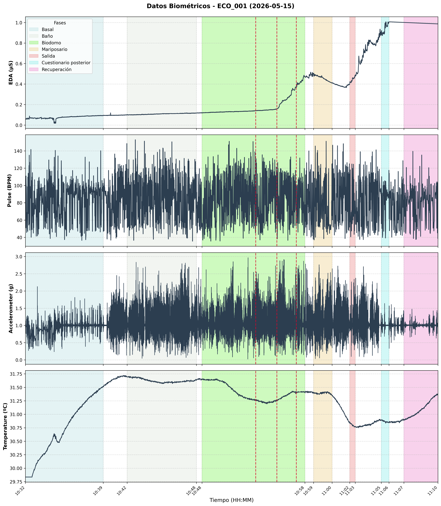
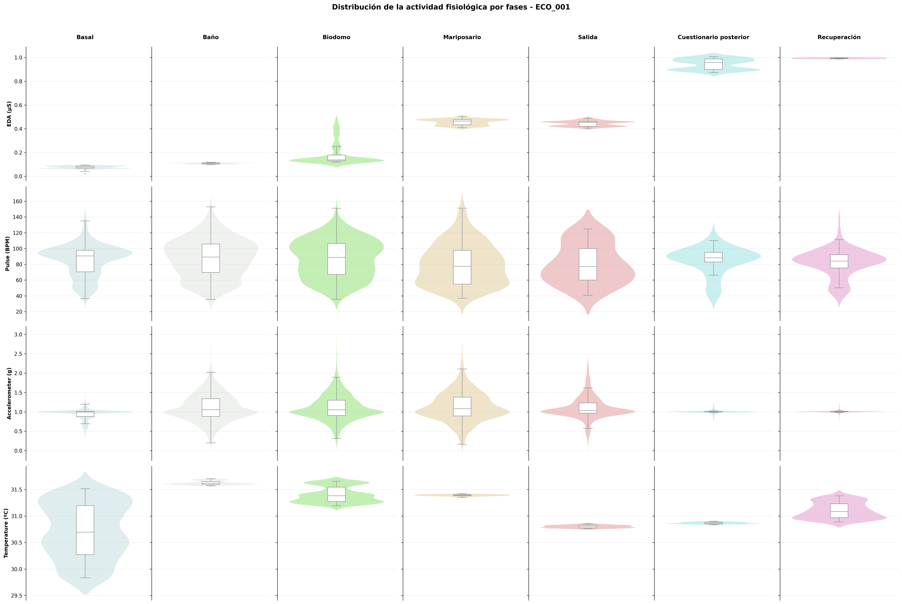

# Extracción y preparación de datos Empatica EmbracePlus para evaluación del estrés

🇪🇸 Español · [🇬🇧 English](README.md)

Conjunto de scripts para descargar, convertir, segmentar y visualizar los datos fisiológicos
de pulseras **Empatica EmbracePlus** en un estudio de evaluación del estrés siguiendo un protocolo de búsqueda de puntos concretos en el
**Parque de las Ciencias de Granada**. El protocolo se realiza antes (`pre`) y después (`post`) de la instalación de
señalización accesible en el parque.

## Diseño del estudio

En cada sesión hay **dos pulseras**:

| Pulsera | Quién la lleva | Qué se usa de ella |
|---|---|---|
| Evaluado | Participante | Señales fisiológicas: EDA, pulso (derivado de picos sistólicos), acelerómetro, temperatura (+ BVP y pasos) |
| Evaluador | Investigador | Solo **tags**: pulsa el botón en cada hito del protocolo |

En un mismo día se evalúa a varias personas con la misma pulsera, por lo que cada participante
se recorta después por su ventana horaria. El protocolo completo (56 tags) está en `Plantilla.pdf`.

## Pipeline

```
dataDownload.sh ─► avroToCSV.py ─► separate_participant.py ─► (revisión manual) ─► tags_def.py ─► graficarTiempoFreq.py
   (S3 → AVRO)    (AVRO→CSV)     (recorte por participante)   tags_mod.csv     (tags finales)      (figuras)
```

| Paso | Script | Qué hace |
|---|---|---|
| 1 | `dataDownload.sh` | Descarga los AVRO de una pulsera y un día desde S3 con Cyberduck CLI (`duck`). |
| 2 | `avroToCSV.py` (+ `avro_utils.py`) | Convierte los AVRO del día en un CSV por sensor (`processed/`). Se comentan/descomentan las exportaciones según la pulsera. |
| 3 | `separate_participant.py` | Recorta los CSV a la ventana horaria de un participante; calcula el pulso (BPM) a partir de los picos sistólicos; extrae los tags del evaluador a `tags_orig.csv` y `tags_mod.csv`. |
| 4 | *(manual)* | Se revisa `tags_mod.csv`: si falta algún tag anotado en papel, se duplica la fila anterior y se ajusta; opcionalmente se añade la columna `anotacion` para anotar algún comportamiento considerable. |
| 5 | `tags_def.py` | Asigna nombre a cada tag por posición y genera `<id>_tags.csv` definitivo. Las filas con `anotacion` se marcan como `extra`. |
| 6 | `graficarTiempoFreq.py` | Genera la figura de series temporales por fases y la de distribuciones (violin + boxplot) por fase y señal. |

## Uso

```bash
pip install -r requirements.txt
# Además: Cyberduck CLI (`duck`) para dataDownload.sh

export EMPATICA_S3_USER="<access key id>"
export EMPATICA_S3_BASE="s3://s3.amazonaws.com/<bucket>/v2/<org>/<estudio>/<sitio>/participant_data"

# 1. Descargar (una vez por pulsera y día)
./dataDownload.sh 2026-05-15 HV        # pulsera del evaluado
./dataDownload.sh 2026-05-15 FY        # pulsera del evaluador

# 2. AVRO -> CSV  (editar FECHA y DISPOSITIVO en avroToCSV.py y activar los sensores deseados)
python avroToCSV.py

# 3. Recortar un participante: <center> <fecha> <dev evaluado> <dev evaluador> <id> <fase> <inicio> <fin>
python separate_participant.py ECO 2026-05-15 HV FY 001 pre 10:32 11:10

# 4. Revisar a mano data/pre/ECO/ECO_001-2026-05-15/ECO_001_tags_mod.csv

# 5. Tags definitivos:  <center> <fecha> <id> <fase>
python tags_def.py ECO 2026-05-15 001 pre

# 6. Figuras
python graficarTiempoFreq.py ECO 2026-05-15 001 pre
```

## Estructura de directorios generada

```
cyberduck/<fecha>/<dispositivo>/raw/              AVRO descargados
cyberduck/<fecha>/<dispositivo>/processed/        CSV de todo el día, por sensor
data/<pre|post>/<center>/<center>_<id>-<fecha>/   CSV del participante, tags y figuras
```

## Fases del protocolo (usadas en las figuras)

Cada fase se delimita con un par de tags (ver `configuracion_fases` en `graficarTiempoFreq.py`).

| Etiqueta en la figura | Descripción | Tag de inicio → tag de fin |
|---|---|---|
| Basal | Basal (EAV 1, asistencia previa y cuestionarios) | `ts_eav1_start` → `ts_sp_end` |
| Baño | Actividad 1: Baño | `ts_inst_task1_start` → `ts_task1_end` |
| Biodomo | Actividad 2: Biodomo | `ts_inst_task2_start` → `ts_task2_end` |
| Mariposario | Actividad 3: Mariposario | `ts_inst_task3_start` → `ts_task3_end` |
| Salida | Actividad 4: Salida | `ts_inst_task4_start` → `ts_task4_end` |
| Cuestionario posterior | EAV 2 y entrevista de sensaciones percibidas | `ts_eav2_start` → `ts_et_end` |
| Recuperación | Tarea de recuperación (línea base) y EAV 3 | `ts_inst_bl_start` → `ts_eav3_end` |

## Ejemplo de salida (participante ECO_001)



* Las líneas rojas discontinuas determinan un tag anotado como `extra`, representing moments when participant has been lost.



## Notas

* Las columnas `datetime_utc` de los CSV están en la **hora local del equipo** que ejecutó
  `avroToCSV.py`, no en UTC estricto; las horas de `separate_participant.py` y el eje X de las figuras
  usan esa misma referencia. Los `unix_timestamp_*` sí son Unix epoch.
* Preprocesado de las figuras: eliminación de outliers por IQR (1.5·IQR) e interpolación lineal;
  acelerómetro como norma euclídea de los tres ejes.
* Los datos de participantes (`cyberduck/`, `data/`) están excluidos en `.gitignore`.